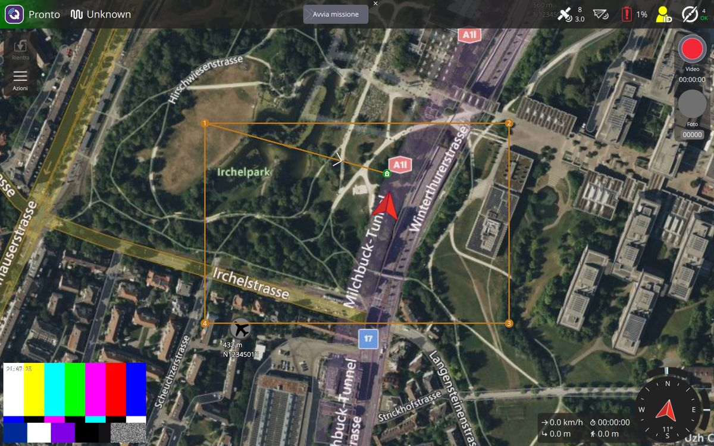
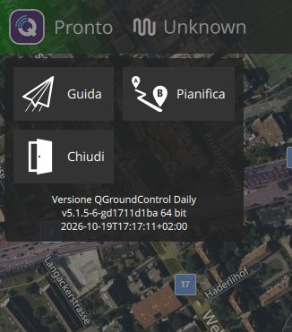
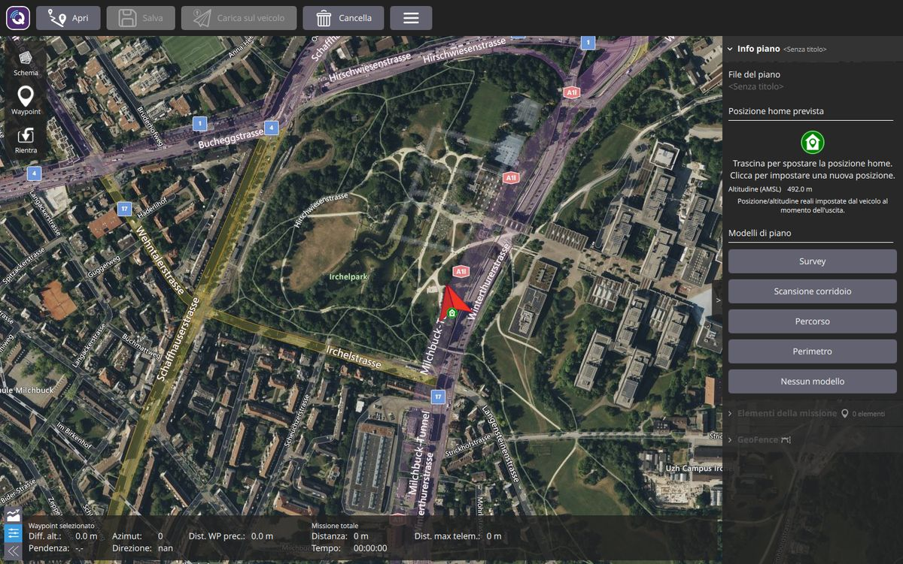
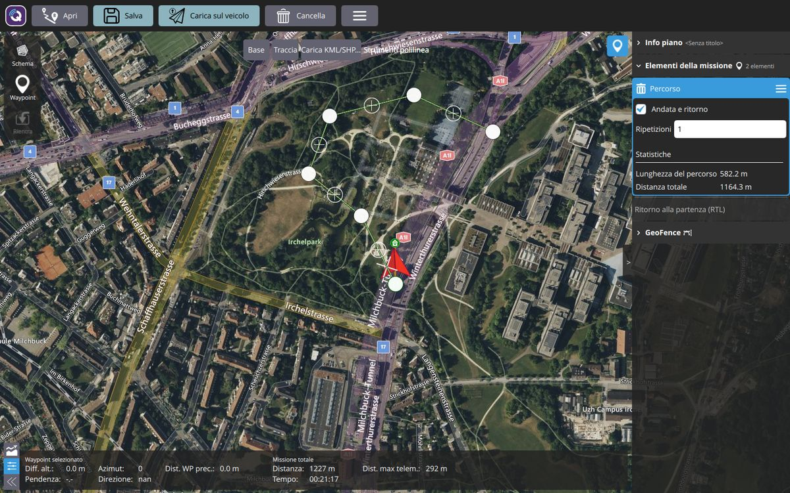
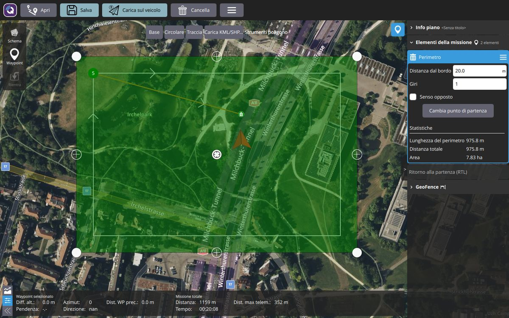

# Guida per l'operatore

Questa guida spiega come usare la dashboard del rover agricolo MEDEA per preparare un lavoro,
avviarlo e seguirlo. Non servono conoscenze di informatica o di ROS.

> **Bozza.** La guida descrive la versione in sviluppo (ottobre 2026). Il collegamento con il rover
> vero passa da un programma ponte che è ancora in preparazione: alcune schermate e alcuni nomi
> cambieranno. Le immagini vengono da un rover simulato.

## Prima di tutto: la sicurezza

- **La dashboard non è l'arresto di emergenza.** Per fermare subito il rover usa il pulsante di
  arresto di emergenza del rover (o del radiocomando), come indicato dal CREA.
- Prima di avviare un lavoro controlla che nell'area non ci siano persone o animali, che il rover sia
  in vista e che la batteria sia carica.

## Avviare il programma

Apri **QGroundControl** dall'icona sul desktop o sul tablet. Si apre la schermata **Guida**, con la
mappa. Quando il rover è acceso e collegato alla rete, il programma si collega da solo.

## La schermata Guida

*Nell'immagine il rover è simulato: l'aereo vicino all'angolo 4 e il video a barre colorate vengono dal
simulatore e non compaiono con il rover vero.*

1. **Pulsante Q** (in alto a sinistra): apre il menu.
2. **Stato del rover**, accanto alla Q:
   - *Disconnesso*: il rover non è collegato;
   - *Pronto*: il rover è collegato e fermo;
   - *Armato*: i motori sono attivi, il rover può muoversi.

   Più a destra c'è la modalità di guida del rover (per ora con nomi in inglese).
3. **Indicatori** (in alto a destra): GPS (numero di satelliti), collegamento, **batteria** in
   percentuale. Tocca un indicatore per vedere i dettagli.
4. **Mappa**: la freccia rossa è il rover; la linea arancione con i numeri è il lavoro caricato sul
   rover; la casetta verde è il punto di partenza.
5. **Video** della camera (in basso a sinistra). Tocca il riquadro per scambiare video e mappa.
   *IN ATTESA DEL VIDEO* vuol dire che la camera non sta inviando immagini.
6. **Valori** (in basso a destra): velocità, distanza dal punto di partenza, tempo di lavoro, distanza
   percorsa; accanto c'è la bussola.
7. **Pulsanti a sinistra**: *Rientra* riporta il rover al punto di partenza; *Azioni* contiene i
   comandi disponibili in quel momento (per esempio *Avvia missione*).
8. **Pulsante rosso** (in alto a destra): registra il video sul computer.

## Il menu

Tocca la **Q** in alto a sinistra:

- **Guida**: la schermata per seguire il rover.
- **Pianifica**: per preparare un lavoro.
- **Chiudi**: chiude il programma (se c'è un lavoro non salvato chiede conferma).

Le impostazioni sono riservate al tecnico e non compaiono nel menu.

## Preparare un lavoro

Apri il menu e scegli **Pianifica**.

### 1. Indica il punto di partenza

Il pannello a destra dice *Clicca sulla mappa per impostare la posizione*: tocca la mappa dove si
trova il rover (di solito vicino alla freccia rossa). Compare la casetta verde, che puoi trascinare.

### 2. Scegli il tipo di lavoro

Sotto *Modelli di piano* scegli:

| Tipo di lavoro | Quando usarlo |
| --- | --- |
| **Percorso** | Il rover segue una strada, un filare o una linea che disegni tu. |
| **Perimetro** | Il rover gira lungo il bordo di un campo o di un'area. |
| **Survey** | Il rover copre tutta un'area con passate parallele (in futuro si chiamerà diversamente). |
| **Nessun modello** | Piano vuoto: aggiungi tu i punti da raggiungere, uno per uno. |

*Scansione corridoio* è pensata per i droni: per ora non serve per il rover.

Percorso, Perimetro e Survey aggiungono alla fine **Ritorno alla partenza**: finito il lavoro, il
rover torna al punto di partenza. Con *Nessun modello* lo aggiungi tu con il pulsante **Rientra**
della barra a sinistra.

### 3a. Percorso

1. Scegli **Percorso**. In alto compaiono gli *Strumenti polilinea*.
2. Premi **Traccia** e tocca sulla mappa i punti del percorso, nell'ordine in cui il rover deve
   passarci. Quando hai finito premi **Fine tracciamento**.
   In alternativa **Base** crea un percorso di esempio da modificare, e **Carica KML/SHP...** carica un
   percorso preparato con un altro programma.
3. Per correggere il percorso:
   - trascina i pallini bianchi per spostare i punti;
   - tocca il **+** a metà di un tratto per aggiungere un punto;
   - tocca un punto e scegli *Rimuovi vertice* per toglierlo.
4. Nel pannello a destra puoi scegliere:
   - **Andata e ritorno**: arrivato in fondo, il rover torna indietro lungo lo stesso percorso;
   - **Ripetizioni**: quante volte ripetere il percorso.

   Sotto *Statistiche* trovi la lunghezza del percorso e la distanza totale da percorrere.

### 3b. Perimetro

1. Scegli **Perimetro**. In alto compaiono gli *Strumenti poligono*.
2. Disegna l'area:
   - **Base** crea un rettangolo: trascina gli angoli sui confini del campo;
   - **Traccia**: tocca gli angoli del campo uno dopo l'altro, poi **Fine tracciamento**;
   - **Carica KML/SHP...** carica un confine preparato con un altro programma.
3. Nel pannello a destra puoi scegliere:
   - **Distanza dal bordo**: quanti metri più all'interno del confine deve passare il rover (per
     esempio per stare lontano da una recinzione). Il giro del rover è la linea sottile dentro l'area;
   - **Giri**: quante volte girare intorno all'area;
   - **Senso opposto**: gira nell'altro verso;
   - **Cambia punto di partenza**: sposta l'angolo da cui il rover comincia il giro.

Se la distanza dal bordo è troppo grande per l'area compare un avviso: riducila, altrimenti il lavoro
non si può salvare né caricare sul rover.

### 3c. Punti a mano (waypoint)

1. Scegli **Nessun modello**.
2. Premi **Waypoint** nella barra a sinistra e tocca sulla mappa i punti da raggiungere, in ordine.
   Ogni tocco aggiunge un punto numerato. Premi di nuovo **Waypoint** per smettere di aggiungere punti.

### 3d. Survey (copertura di un'area)

Disegna l'area come per il perimetro. Il rover la percorre con passate parallele: **Passo** è la
distanza tra una passata e l'altra, **Angolo** è la direzione delle passate. Questa schermata ha
ancora molte opzioni da drone e verrà semplificata.

### 4. Salva il lavoro (facoltativo)

**Salva** (in alto) salva il lavoro in un file, per riusarlo un altro giorno; **Apri** lo riapre.
**Cancella** svuota il piano (chiede conferma).

### 5. Carica il lavoro sul rover

Premi **Carica sul veicolo** (in alto). Il pulsante è evidenziato quando il lavoro sullo schermo è
diverso da quello sul rover.

Se compare *Il piano ha elementi incompleti*, un elemento non è finito: nell'elenco a destra è
segnato con un punto interrogativo rosso. Di solito manca da disegnare il percorso o l'area.

## Eseguire il lavoro

1. Apri il menu e scegli **Guida**.
2. Controlla sulla mappa che la linea arancione sia il lavoro giusto.
3. In alto compare **Avvia missione**: trascina il cursore verso destra fino in fondo per confermare
   (lo stesso comando è anche in **Azioni**).
4. Lo stato diventa *Armato* e il rover parte. Segui il lavoro sulla mappa e nel video.
5. Per far tornare il rover al punto di partenza usa **Rientra** e conferma trascinando il cursore.

I pulsanti grandi dedicati al rover (Avvia lavoro, Pausa/Riprendi, Torna, Stop) sono in preparazione.

## Problemi comuni

| Cosa vedi | Cosa fare |
| --- | --- |
| *Disconnesso - Clicca per connetterti manualmente* | Il rover non è collegato. Controlla che sia acceso e che il computer o il tablet sia sulla rete del rover. Se il problema resta, chiama il tecnico. |
| *IN ATTESA DEL VIDEO* | La camera non invia immagini. Controlla che sia accesa; se il problema resta, chiama il tecnico. |
| *Il piano ha elementi incompleti* | Finisci di disegnare l'elemento segnato con il punto interrogativo rosso. |
| Avviso sulla distanza dal bordo (Perimetro) | Riduci la *Distanza dal bordo*. |
| La batteria diventa rossa | Fai rientrare il rover e ricaricalo. |
| Serve cambiare un'impostazione (video, collegamento, lingua...) | Chiama il tecnico: le impostazioni sono nascoste di proposito. |
