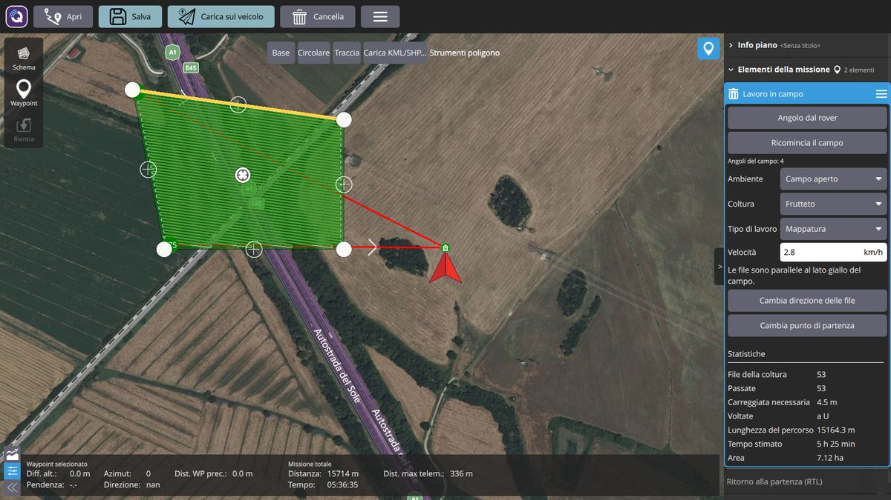
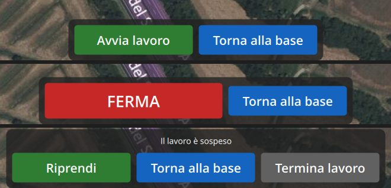
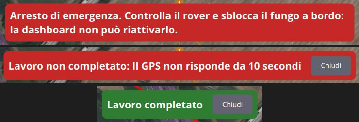

# Guida per l'operatore

Questa guida spiega come usare la dashboard del rover agricolo MEDEA per preparare un lavoro,
avviarlo e seguirlo. Non servono conoscenze di informatica o di ROS.

> **Bozza.** La guida descrive la versione in sviluppo (ottobre 2026). Il collegamento con il rover
> passa da un programma ponte (bridge) provato finora con un rover simulato: alcune schermate e alcuni
> nomi cambieranno. Le immagini vengono dal rover simulato.

## Prima di tutto: la sicurezza

- **La dashboard non è l'arresto di emergenza.** In caso di pericolo premi il **fungo di emergenza**
  sul rover: toglie corrente ai motori senza passare dal WiFi. Il pulsante **FERMA** della dashboard
  ferma il rover, ma il comando viaggia sulla rete e potrebbe arrivare in ritardo.
- Prima di avviare un lavoro controlla che nell'area non ci siano persone o animali, che il rover sia
  in vista e che la batteria sia carica.

## Avviare il programma

Apri **QGroundControl** dall'icona sul desktop del computer. Si apre la schermata **Guida**, con la
mappa. Quando il rover è acceso e collegato alla rete, il programma si collega da solo.

## La schermata Guida

*Nell'immagine il rover è simulato.*

1. **Pulsante Q** (in alto a sinistra): apre il menu.
2. **Stato del rover**, il riquadro colorato accanto alla Q. Serve solo da leggere:

   | Stato | Colore | Cosa vuol dire |
   | --- | --- | --- |
   | *Non collegato* | grigio | La dashboard non riceve dati dal rover. |
   | *Avvio in corso* | grigio | Il rover si sta accendendo: aspetta. |
   | *Pronto* | verde | Il rover è fermo e può ricevere un lavoro. |
   | *Al lavoro* | blu | Il rover sta eseguendo il lavoro. |
   | *In pausa* | giallo | Il rover è fermo con i motori spenti; il lavoro è sospeso e si può riprendere. |
   | *Rientro* | blu | Il rover torna al punto di partenza. |
   | *Guida manuale* | viola | Il rover è guidato a mano (joystick o radiocomando). |
   | *Guasto* | arancione | Qualcosa non funziona: l'avviso al centro dice cosa. |
   | *Arresto di emergenza* | rosso | È stato premuto il fungo o è scattata una sicurezza. |

3. **Indicatori** (in alto a destra):
   - **posizione**: *RTK fisso* (verde, la precisione giusta per lavorare), *RTK float* (giallo,
     aspetta che diventi fisso), *GPS senza RTK* (arancione, precisione di qualche metro), *Nessuna
     posizione* (rosso);
   - **batteria** in percentuale (se il rover ne ha due, quella più scarica).
4. **Riquadro del lavoro** (in alto a sinistra), quando sul rover c'è un lavoro: percentuale fatta,
   punto verso cui va il rover (*Punto 3 di 12*), quanto manca in metri e in minuti, velocità in km/h.
   **Registro eventi** apre, nello stesso riquadro, l'elenco dei messaggi del rover con l'ora (i più
   recenti in alto); i pulsanti in basso restano utilizzabili.
5. **Mappa**: la freccia rossa è il rover; la linea arancione con i numeri è il lavoro caricato sul
   rover; il numero verde è il punto verso cui il rover sta andando; la linea rossa è il tragitto già
   fatto; la casetta verde è il punto di partenza.
6. **Video** della camera (in basso a sinistra). Tocca il riquadro per scambiare video e mappa.
   *IN ATTESA DEL VIDEO* vuol dire che la camera non sta inviando immagini.
7. **Valori** (in basso a destra): velocità, distanza dal punto di partenza, tempo di lavoro, distanza
   percorsa; accanto c'è la bussola.
8. **Pulsanti del rover** (in basso al centro): compaiono solo quelli utili in quel momento, vedi
   [Eseguire il lavoro](#eseguire-il-lavoro).
9. **Avvisi** (al centro, in alto): arresto di emergenza, guasto, lavoro completato o non completato,
   vedi [Avvisi](#avvisi).

## Il menu

Tocca la **Q** in alto a sinistra:

- **Guida**: la schermata per seguire il rover.
- **Pianifica**: per preparare un lavoro.
- **Chiudi**: chiude il programma (se c'è un lavoro non salvato chiede conferma).

Le impostazioni sono riservate al tecnico e non compaiono nel menu.

## Preparare un lavoro

Apri il menu e scegli **Pianifica**.

### 1. Indica il punto di partenza

Il pannello a destra dice *Clicca sulla mappa per impostare la posizione*: tocca la mappa dove si
trova il rover (di solito vicino alla freccia rossa). Compare la casetta verde, che puoi trascinare.

### 2. Scegli il tipo di lavoro

Sotto *Modelli di piano* scegli:

| Tipo di lavoro | Quando usarlo |
| --- | --- |
| **Lavoro in campo** | Il rover lavora lungo le file di una coltura, con le voltate in capezzagna. È il lavoro di tutti i giorni. |
| **Percorso** | Il rover segue una strada, un filare o una linea che disegni tu. |
| **Perimetro** | Il rover gira lungo il bordo di un campo o di un'area. |
| **Survey** | Copertura di un'area con passate parallele, pensata per i droni: per il rover usa *Lavoro in campo*. |
| **Nessun modello** | Piano vuoto: aggiungi tu i punti da raggiungere, uno per uno. |

*Scansione corridoio* è pensata per i droni: per ora non serve per il rover.

Lavoro in campo, Percorso, Perimetro e Survey aggiungono alla fine **Ritorno alla partenza**: finito il lavoro, il
rover torna al punto di partenza. Con *Nessun modello* lo aggiungi tu con il pulsante **Rientra**
della barra a sinistra.

### 3a. Lavoro in campo

1. Scegli **Lavoro in campo**. In alto compaiono gli *Strumenti poligono*.
2. Indica il campo, in uno di questi modi:
   - **dal rover** (il più preciso): porta il rover in un angolo del campo e premi **Angolo dal rover**,
     poi nell'angolo successivo e così via, girando intorno al campo. Con tre angoli il campo compare
     sulla mappa. **Ricomincia il campo** cancella gli angoli;
   - **sulla mappa**: **Base** crea un rettangolo da trascinare sui confini, **Traccia** permette di
     toccare gli angoli uno dopo l'altro (poi **Fine tracciamento**), **Carica KML/SHP...** carica un
     confine preparato con un altro programma. La mappa satellitare può essere spostata di qualche metro:
     controlla che le file cadano davvero sulle piante.
3. Nel pannello a destra scegli:
   - **Ambiente**: *Campo aperto* o *Serra*;
   - **Coltura**: vigneto, frutteto, orticole in pieno campo, mais, orticole in serra. La coltura imposta
     la distanza tra le file e lo spazio per girare a fine fila;
   - **Tipo di lavoro**: mappatura, rilevamento infestanti, diserbo, mappatura NDVI o NDRE, irrorazione;
   - **Velocità** in km/h (2,8 di solito, al massimo 3).
4. Sulla mappa le **file** sono le linee verdi, il **lato giallo** del campo è quello a cui sono parallele.
   Se le file vanno nell'altro verso premi **Cambia direzione delle file**. **Cambia punto di partenza**
   sposta l'angolo da cui il rover comincia.
5. Sotto *Statistiche* trovi quante file ci sono, la lunghezza del percorso e il **tempo stimato**.

Se compare un avviso rosso il lavoro non si può caricare sul rover. I casi più comuni:

- *Le voltate a fine fila escono dal campo*: lo spazio a fine fila non basta per girare. Chiedi al tecnico
  di controllare la capezzagna o il raggio di sterzata;
- *Nel campo non entra nessuna fila*: il campo è troppo piccolo o le file vanno nella direzione sbagliata
  (prova **Cambia direzione delle file**);
- *La capezzagna è troppo larga per questo campo*: il campo è troppo stretto rispetto allo spazio a fine
  fila.

### 3b. Percorso

1. Scegli **Percorso**. In alto compaiono gli *Strumenti polilinea*.
2. Premi **Traccia** e tocca sulla mappa i punti del percorso, nell'ordine in cui il rover deve
   passarci. Quando hai finito premi **Fine tracciamento**.
   In alternativa **Base** crea un percorso di esempio da modificare, e **Carica KML/SHP...** carica un
   percorso preparato con un altro programma.
3. Per correggere il percorso:
   - trascina i pallini bianchi per spostare i punti;
   - tocca il **+** a metà di un tratto per aggiungere un punto;
   - tocca un punto e scegli *Rimuovi vertice* per toglierlo.
4. Nel pannello a destra puoi scegliere:
   - **Andata e ritorno**: arrivato in fondo, il rover torna indietro lungo lo stesso percorso;
   - **Ripetizioni**: quante volte ripetere il percorso.

   Sotto *Statistiche* trovi la lunghezza del percorso e la distanza totale da percorrere.

### 3c. Perimetro

1. Scegli **Perimetro**. In alto compaiono gli *Strumenti poligono*.
2. Disegna l'area:
   - **Base** crea un rettangolo: trascina gli angoli sui confini del campo;
   - **Traccia**: tocca gli angoli del campo uno dopo l'altro, poi **Fine tracciamento**;
   - **Carica KML/SHP...** carica un confine preparato con un altro programma.
3. Nel pannello a destra puoi scegliere:
   - **Distanza dal bordo**: quanti metri più all'interno del confine deve passare il rover (per
     esempio per stare lontano da una recinzione). Il giro del rover è la linea sottile dentro l'area;
   - **Giri**: quante volte girare intorno all'area;
   - **Senso opposto**: gira nell'altro verso;
   - **Cambia punto di partenza**: sposta l'angolo da cui il rover comincia il giro.

Se la distanza dal bordo è troppo grande per l'area compare un avviso: riducila, altrimenti il lavoro
non si può salvare né caricare sul rover.

### 3d. Punti a mano (waypoint)

1. Scegli **Nessun modello**.
2. Premi **Waypoint** nella barra a sinistra e tocca sulla mappa i punti da raggiungere, in ordine.
   Ogni tocco aggiunge un punto numerato. Premi di nuovo **Waypoint** per smettere di aggiungere punti.

### Survey

È il modello per coprire un'area con un drone. Per il rover usa **Lavoro in campo**, che conosce le
file della coltura e le voltate.

### 4. Salva il lavoro (facoltativo)

**Salva** (in alto) salva il lavoro in un file, per riusarlo un altro giorno; **Apri** lo riapre.
**Cancella** svuota il piano (chiede conferma).

### 5. Carica il lavoro sul rover

Premi **Carica sul veicolo** (in alto). Il pulsante è evidenziato quando il lavoro sullo schermo è
diverso da quello sul rover. Appena il rover ha ricevuto il lavoro, il programma passa da solo alla
schermata **Guida**, da dove lo avvii.

Se compare *Il piano ha elementi incompleti*, un elemento non è finito: nell'elenco a destra è
segnato con un punto interrogativo rosso. Di solito manca da disegnare il percorso o l'area.

## Eseguire il lavoro

1. Dopo **Carica sul veicolo** sei già nella schermata **Guida** (altrimenti: menu → **Guida**).
   Controlla sulla mappa che la linea arancione sia il lavoro giusto e che lo stato sia *Pronto*.
2. Premi **Avvia lavoro** e conferma con **Sì**. Il rover si mette in moto da solo e lo stato diventa
   *Al lavoro*. Segui il lavoro sulla mappa, nel riquadro del lavoro e nel video.
3. Durante il lavoro i pulsanti in basso sono:
   - **FERMA** (rosso, il più grande): il rover si ferma subito e spegne i motori. Il lavoro **non** si
     perde: resta sospeso (*In pausa*);
   - **Torna alla base** (chiede conferma): il rover interrompe il lavoro, torna al punto di partenza
     (*Rientro*) e si ferma.
4. Quando il rover è *In pausa* i pulsanti sono:
   - **Riprendi**: il rover riparte da dove si era fermato;
   - **Torna alla base**: come sopra;
   - **Termina lavoro** (chiede conferma): il lavoro viene chiuso e non si può più riprendere, solo
     ricominciare da capo con *Avvia lavoro*. Il rover resta dov'è.
5. Finito il lavoro il rover si ferma (*Pronto*) e compare l'avviso verde **Lavoro completato**. Il
   lavoro resta sul rover: per ripeterlo basta premere di nuovo **Avvia lavoro**.

Se il rover non può eseguire un comando, in alto compare un riquadro giallo con il motivo, per esempio
*Avvia lavoro: nessun lavoro caricato*. Toccalo per chiuderlo.

**FERMA** agisce subito, senza conferma, ed è l'unico modo di fermare il rover dalla dashboard: non fa
mai perdere il lavoro. **Non è l'arresto di emergenza**: in caso di pericolo premi il fungo sul rover.

### Avvisi

- **Arresto di emergenza** (rosso): è stato premuto il fungo o è scattata una sicurezza. Il rover è
  fermo e la dashboard non mostra pulsanti: controlla il rover e sblocca il fungo a bordo. La dashboard
  non può riattivarlo.
- **Guasto** (arancione): il rover segnala un problema e dice quale, per esempio *Guasto: il GPS non
  risponde*. Chiama il tecnico.
- **Lavoro completato** (verde) e **Lavoro non completato** (rosso, con il motivo): restano finché non
  premi **Chiudi**. Un lavoro interrotto da un arresto di emergenza o da un guasto non si riprende: va
  avviato di nuovo.

## Problemi comuni

| Cosa vedi | Cosa fare |
| --- | --- |
| *Non collegato* | Il rover non è collegato. Controlla che sia acceso e che il computer sia sulla rete del rover. Se il problema resta, chiama il tecnico. |
| *Avvio in corso* per più di qualche minuto | Il rover non riesce ad avviarsi: chiama il tecnico. |
| *Arresto di emergenza* | Controlla il rover, poi sblocca il fungo a bordo. Il lavoro interrotto va avviato di nuovo. |
| *Guasto* | Leggi l'avviso e chiama il tecnico. |
| *Guida manuale* | Qualcuno sta guidando il rover a mano: la dashboard non mostra pulsanti finché la guida manuale non finisce. |
| *RTK float* o *GPS senza RTK* | La posizione non è abbastanza precisa: aspetta qualche minuto all'aperto prima di avviare il lavoro. |
| *IN ATTESA DEL VIDEO* | La camera non invia immagini. Controlla che sia accesa; se il problema resta, chiama il tecnico. |
| *Il piano ha elementi incompleti* | Finisci di disegnare l'elemento segnato con il punto interrogativo rosso. |
| *Nessun lavoro sul rover* (sopra i pulsanti) o *nessun lavoro caricato* | Prepara il lavoro e caricalo: *Pianifica* → **Carica sul veicolo**. |
| Riquadro giallo con un messaggio del rover | Leggi il motivo: il rover non ha eseguito il comando o segnala un problema. Toccalo per chiuderlo. |
| *il rover non ha risposto* o *Il rover non è collegato* | Controlla che il rover sia acceso e in rete, poi riprova. Se il problema resta, chiama il tecnico. |
| Avviso sulla distanza dal bordo (Perimetro) | Riduci la *Distanza dal bordo*. |
| La batteria diventa rossa | Fai rientrare il rover e ricaricalo. |
| Serve cambiare un'impostazione (video, collegamento, lingua...) | Chiama il tecnico: le impostazioni sono nascoste di proposito. |
