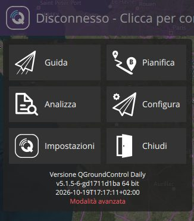
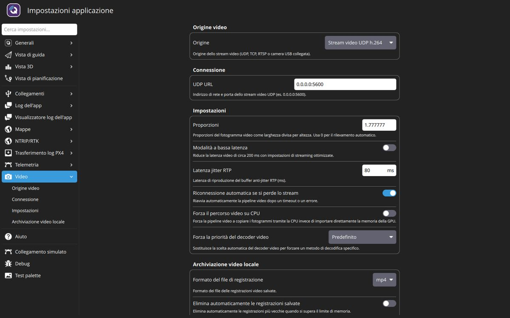

# Guida per il tecnico

Questa guida è per chi installa, configura e mantiene la dashboard del rover MEDEA (QGroundControl
personalizzato). Per l'uso quotidiano vedi la [guida per l'operatore](guida-operatore.md); per
l'elenco delle modifiche e i motivi vedi il [changelog](CHANGELOG.md).

> **Bozza.** Descrive la versione in sviluppo (novembre 2026). Il collegamento con il rover (bridge ROS 2 sulla
> Jetson) è provato nel simulatore, non ancora sul rover vero; vedi `docs/integrazione-ros2.md` del repository
> `medea_hmi`.

## Modalità tecnico (modalità avanzata)

L'operatore vede solo **Guida**, **Pianifica** e **Chiudi**. Tutto ciò che è tecnico è dietro la
**modalità avanzata**, che è spenta a ogni avvio del programma.

**Attivarla:** tocca la **Q** in alto a sinistra, poi **tieni premuto** sulla scritta della versione in
fondo al menu (su desktop basta anche Shift+clic) e conferma con **Sì**. Sotto la versione compare in
rosso *Modalità avanzata*.



**Disattivarla:** stesso gesto, poi conferma *Disattivare la modalità avanzata?*. In ogni caso si
spegne alla chiusura del programma: prima di lasciare la postazione all'operatore disattivala o
riavvia il programma.

In modalità avanzata tornano:

- nel menu: **Analizza**, **Configura** (configurazione del veicolo) e **Impostazioni**;
- negli indicatori della barra in alto: la parte "espandi" con le impostazioni (per esempio la base
  RTK nel pannello GPS);
- nella barra in alto: il pannello dello stato (messaggi del veicolo, sensori, arma/disarma) e il menu
  delle modalità, che in modalità operatore non si aprono;
- nella Fly View: l'ingranaggio delle impostazioni della camera (griglia, adattamento, ripristino e
  formattazione della memoria) e, con il rover, la barra a sinistra con il menu *Azioni*;
- nella Plan View: *Info veicolo* (firmware e tipo di veicolo per la pianificazione), *Predefiniti*,
  *Punti di raccolta*, *Trasforma* e *Impostazioni iniziali della camera*.

## Prima installazione di una postazione

1. **Lingua:** il valore predefinito è *Sistema*: su un computer in italiano l'interfaccia è già in
   italiano. Altrimenti *Impostazioni → Generali → Lingua → Italiano* e riavvia.
2. **Collegamento con il rover:** il programma ascolta i veicoli MAVLink su UDP (porta 14550) e si
   collega da solo. La connessione automatica a Pixhawk, radio SiK e LibrePilot è disattivata. I dati
   del rover arrivano dal [bridge](#collegamento-con-il-rover-bridge), che gira sulla Jetson del rover e manda
   MAVLink via WiFi: serve un collegamento UDP verso la Jetson (vedi la sezione). Collegamenti manuali: *Impostazioni → Collegamenti*.
3. **Video:** vedi la sezione [Video](#video).
4. **Schermo:** unità europee (m, km/h, ettari, °C) e scala dell'interfaccia al 115% sono già
   impostate (*Impostazioni → Generali*). Per lavorare al sole scegli *Schema colori → Esterni*
   (chiaro): sul PC il predefinito è *Interni* (scuro), sul tablet *Esterni*.
5. **Prova:** senza rover puoi provare la postazione con il [rover finto](#prove-senza-rover) e con uno
   [stream video di prova](#provare-il-video-senza-camere).

## Video

Il video è **sempre attivo** e non si può disattivare. Di serie il programma aspetta uno stream
**UDP h.264 sulla porta 5600** (indirizzo `0.0.0.0:5600`): se la camera invia lì, il video compare
nella Fly View senza configurare nulla. Nelle impostazioni si sceglie solo il profilo dello stream.



*Impostazioni → Video*:

- **Origine video → Origine:** *Stream video UDP h.264* (predefinito), *UDP h.265*, *Stream video
  RTSP*, *TCP*, *MPEG-TS* o una camera USB collegata (compare con il suo nome).
- **Connessione:** l'indirizzo dello stream. Per UDP indirizzo e porta su cui ascoltare (per esempio
  `0.0.0.0:5600`); per RTSP l'URL della camera (per esempio `rtsp://192.168.1.20:8554/rgb`).
- **Impostazioni:**
  - *Modalità a bassa latenza*: circa 200 ms di ritardo in meno, a costo di più scatti se la rete
    perde pacchetti;
  - *Forza la priorità del decoder video*: se il riquadro resta su *IN ATTESA DEL VIDEO* anche se la
    camera trasmette, prova *Forza decoder software* (serve il riavvio).
- **Archiviazione video locale:** formato e spazio massimo delle registrazioni fatte con il pulsante
  rosso della Fly View.

Chiedere che le camere del rover trasmettano **H.264 in profilo baseline o main**: nelle prove uno
stream in profilo *high* non veniva mostrato con il decoder automatico.

Per mostrare sia la camera RGB sia quella termica andrà valutato il protocollo camera MAVLink (il
bridge annuncia gli stream e QGroundControl permette di scegliere quale vedere): oggi le impostazioni
gestiscono uno stream alla volta.

### Provare il video senza camere

Con GStreamer installato (è un requisito di QGroundControl) si può inviare un'immagine di prova.

UDP h.264 sulla porta predefinita, senza toccare le impostazioni:

```bash
gst-launch-1.0 videotestsrc is-live=true \
  ! video/x-raw,width=640,height=480,framerate=25/1 \
  ! x264enc tune=zerolatency bitrate=800 key-int-max=25 ! video/x-h264,profile=baseline \
  ! rtph264pay config-interval=1 pt=96 ! udpsink host=127.0.0.1 port=5600
```

RTSP, con il server [MediaMTX](https://github.com/bluenviron/mediamtx) (impostare poi l'URL
`rtsp://127.0.0.1:8554/camera`):

```bash
printf 'paths:\n  all_others:\n' > mediamtx.yml
mediamtx mediamtx.yml &
gst-launch-1.0 videotestsrc is-live=true \
  ! video/x-raw,width=1280,height=720,framerate=25/1 \
  ! x264enc tune=zerolatency bitrate=1500 key-int-max=25 ! video/x-h264,profile=baseline \
  ! rtspclientsink location=rtsp://127.0.0.1:8554/camera
```

## Collegamento con il rover (bridge)

QGroundControl parla solo MAVLink; il codice del rover (`rovercrea-dua`) è ROS 2. In mezzo c'è il **bridge**
`medea_bridge` (repository `medea_hmi`, cartella `src/medea_bridge`, con il suo `README.md`), un nodo ROS 2 che
**gira sulla Jetson del rover** insieme al nodo `medea_watchdog`. Sul WiFi passa solo MAVLink: sul laptop basta
QGroundControl.

- Legge posizione (odometria del rover, convertita in lat/lon con il punto di partenza del rover), stato e messaggi
  del rover e li manda a QGroundControl.
- Trasforma i pulsanti dell'operatore in comandi del rover (avvio, pausa, ripresa, rientro, fine lavoro) e risponde a
  QGroundControl quando il rover li ha eseguiti.
- Prova sul rover i lavori caricati con *Carica sul veicolo*: se il rover non riesce a costruire il percorso, il
  caricamento fallisce con il motivo.
- **Se QGroundControl si scollega per più di 3 s, il rover si ferma** (pausa e motori spenti) e non riparte da solo;
  il watchdog lo ferma anche se il bridge si blocca.

Collegamento: sulla Jetson il bridge ascolta su UDP 14550. Sul laptop si crea una volta un collegamento
*Impostazioni → Collegamenti → Aggiungi → UDP* verso `<IP della Jetson>:14550`, con *Collega automaticamente*.
Configurazione del bridge: `src/medea_bridge/config/bridge.yaml` (dettagli nel `README.md` del bridge).

Cosa si vede in QGroundControl:

- se il bridge non risponde per più di qualche secondo, il rover risulta *Non collegato*; se il bridge c'è ma il
  software del rover non è ancora partito, *Avvio in corso*;
- lo stato del rover (la modalità MAVLink) ha nomi italiani: *Pronto*, *Al lavoro*, *In pausa*,
  *Rientro*, *Guida manuale*, *Arresto di emergenza*, *Avvio in corso*, *Guasto*;
- se il rover rifiuta un comando, il motivo compare in un riquadro giallo in alto. Gli avvisi accaduti mentre
  QGroundControl era scollegato arrivano alla riconnessione, con l'ora ("Alle 13:21:02: …");
- l'invio dell'heartbeat di QGroundControl (*Impostazioni → Telemetria*) non si può spegnere: senza heartbeat il rover
  si fermerebbe.

### Guida manuale con il joystick

Un controller PS4 o PS5 collegato al laptop (USB o Bluetooth) compare nella barra in alto (icona del joystick,
verde mentre guida il rover). Nella schermata Guida compare il pannello **Guida con il joystick**: dopo la conferma il
lavoro va in pausa e il rover si guida tenendo premuti **L1 e R1** (stick destro avanti/indietro, stick sinistro
sterzo); **Termina guida manuale** spegne i motori, poi *Riprendi* continua il lavoro dalla nuova posizione. Fuori
dalla guida manuale il joystick non comanda nulla. Se il rover va o sterza al contrario: `manual.invert_forward` /
`manual.invert_steering` in `config/bridge.yaml` del bridge; i numeri dei pulsanti si vedono in *Configura →
Joystick* (modalità tecnico).

Ogni controller nuovo va **calibrato una volta** in *Configura → Joystick* (modalità tecnico, rover collegato): anche
se la pagina dice "Pronto", QGroundControl non manda nulla da un joystick mai calibrato. Finché non lo è, il pannello
mostra l'avviso e *Guida con il joystick* resta disattivato. Il "modo radiocomando" è sempre 2 (impostazione nascosta,
torna a 2 a ogni avvio): con qualunque controller stick destro avanti/indietro, sinistro sterzo. Il bridge ignora il
10% centrale della corsa degli stick (`manual.deadzone`), perché a stick lasciato i gamepad non tornano esattamente
a zero. Se si stacca il controller con la pagina di calibrazione aperta QGroundControl non si chiude più (prima
andava in crash). La calibrazione si salva per quel modello di controller;
alla fine QGroundControl propone di abilitarlo: non serve (lo abilita il pannello solo durante la guida manuale).

**Prova di un controller** (PC, repository `medea_hmi`, simulatore):

1. Collegare il controller (USB, oppure Bluetooth: PS4 *share* + *PS*, PS5 *create* + *PS* tenuti premuti finché la
   luce lampeggia). Deve comparire l'icona del joystick nella barra in alto.
2. `bin/medea.sh` (simulatore + bridge + QGroundControl); in un altro terminale `bin/bridge_sim.sh drive`: una riga
   dice cosa il bridge manda al rover ("avanti 0.40 m/s, sterzo a sinistra 12°") e cosa fa il rover simulato; tutto
   viene registrato anche in `logs/bridge_sim/drive/<data>.csv`.
3. Modalità tecnico → *Configura → Joystick*: muovere gli stick e premere L1 e R1, controllare che si muovano gli
   indicatori giusti; poi *Calibra* e seguire il wizard lasciando il modo 2 (stick sinistro gas/imbardata, destro
   beccheggio/rollio).
4. Schermata Guida, **senza** entrare in guida manuale: muovere il controller → il monitor dice "nessun comando dal
   joystick" e il rover resta fermo.
5. *Guida con il joystick* → Sì. Senza L1+R1: "fermo". Con L1+R1 tenuti:
   - stick destro **avanti** → "avanti", il rover sulla mappa va nella direzione della freccia;
   - stick sinistro **a sinistra** → "sterzo a sinistra", il rover gira a sinistra (rotazione positiva).

   Se uno dei due è al contrario: `manual.invert_forward` / `manual.invert_steering: true` in
   `src/medea_bridge/config/bridge_sim.yaml` **e** in `bridge.yaml` (il rover vero), poi `bin/bridge_sim.sh build`,
   `stop` e `start` (il YAML viene copiato in compilazione).
6. Lasciare L1 o R1 durante la marcia → il rover si ferma subito. Spegnere il controller (tenere *PS* 10 s) durante la
   guida → QGroundControl esce dalla guida manuale e il rover si disarma.
7. *Termina guida manuale* → il rover si disarma; muovere il controller → nessun comando.

### Pulsanti, stato e avanzamento del rover

Un rover MAVLink con autopilota generico (`MAV_AUTOPILOT_GENERIC`), come quello presentato dal bridge,
usa il **FirmwarePlugin del rover MEDEA** (`src/FirmwarePlugin/MedeaRover/`). Per l'operatore la
schermata Guida ha allora solo i pulsanti grandi in basso, mostrati secondo lo stato del rover:

| Pulsante | Quando compare | Comando MAVLink | Al rover |
| --- | --- | --- | --- |
| Avvia lavoro (con conferma) | *Pronto*, attivo se c'è un lavoro caricato | `MAV_CMD_MISSION_START` | `start_mission` |
| **FERMA** | *Al lavoro*, *Rientro* | `MAV_CMD_DO_PAUSE_CONTINUE` (0) | `pause` (si ferma, motori spenti, lavoro sospeso) |
| Riprendi | *In pausa* | `MAV_CMD_DO_PAUSE_CONTINUE` (1) | `resume` |
| Torna alla base (con conferma) | *Pronto*, *Al lavoro*, *In pausa*, solo con un punto di partenza (`HOME_POSITION`) e a più di 2 m da lì | `MAV_CMD_NAV_RETURN_TO_LAUNCH` | `return_home` |
| Termina lavoro (con conferma) | *In pausa* | `MAV_CMD_COMPONENT_ARM_DISARM` (0) | `stop` (chiude il lavoro) |

- *FERMA* è l'unico stop della dashboard e non fa perdere il lavoro; *Termina lavoro* è lo STOP delle
  regole operative del CREA. L'arresto di emergenza è solo il fungo elettrico sul rover.
- Il rover si arma da solo quando parte: non c'è un passo "arma" separato.
- Gli stati sono le modalità MAVLink, riconosciute dal numero (custom_mode) e mostrate con i nomi
  tradotti di QGroundControl; i nomi in `bridge.yaml` non vengono usati:

  | custom_mode | Stato | Selezionabile | `HEARTBEAT.system_status` |
  | --- | --- | --- | --- |
  | 1 | Pronto | sì | STANDBY |
  | 2 | Al lavoro | sì | ACTIVE |
  | 3 | In pausa | sì | ACTIVE / STANDBY |
  | 4 | Rientro | sì | ACTIVE |
  | 5 | Guida manuale | no | ACTIVE / STANDBY |
  | 6 | Arresto di emergenza | no | EMERGENCY |
  | 7 | Avvio in corso | no | BOOT |
  | 8 | Guasto | no | CRITICAL |

- Lo **stato** (pillola colorata in alto), l'**avanzamento** (riquadro in alto a sinistra) e gli
  **avvisi** (al centro) vengono da `MedeaRoverJobStatus` (C++, nello stesso FirmwarePlugin):
  - l'avanzamento è la distanza percorsa lungo il lavoro caricato sul rover, dalla posizione di partenza
    (*home*) al punto in corso (`MISSION_CURRENT.seq`), sulla lunghezza totale. Il tempo rimanente usa
    la velocità media dell'ultimo minuto (all'inizio la velocità di crociera delle impostazioni,
    2,8 km/h);
  - lo stato del lavoro viene da `MISSION_CURRENT.mission_state`: *Lavoro completato* quando passa da
    attivo/in pausa a COMPLETE; *Lavoro non completato* se durante il lavoro il rover va in *Arresto di
    emergenza* o *Guasto* (con l'ultimo messaggio di errore del rover come motivo);
  - l'avviso di *Guasto* riporta l'ultimo `STATUSTEXT` di gravità *error* o superiore.
- L'indicatore di posizione dice *RTK fisso*, *RTK float*, *GPS senza RTK* o *Nessuna posizione*
  (da `GPS_RAW_INT.fix_type`); in modalità avanzata il tocco apre la pagina GPS di QGroundControl.
- Con due pacchi batteria il bridge invia due `BATTERY_STATUS` (id 0 e 1): l'indicatore mostra il più
  scarico, il dettaglio è nella pagina della batteria (modalità avanzata).
- In modalità operatore sono nascosti il pulsante rosso di registrazione video (sembrava un arresto di
  emergenza; la registrazione è un compito del tecnico) e la modalità accanto allo stato (è la stessa
  informazione).
- Per questo rover sono spenti i comandi guidati generici di QGroundControl (*Avvia missione*,
  *Continua missione*, *Rientra*, *Vai qui*, arma/disarma) e la finestra *Piano completato*: il lavoro
  resta sul rover per essere ripetuto.
- Dopo un caricamento riuscito dalla Plan View il programma passa da solo alla schermata Guida.

Il file di *MAVLink Actions* `src/medea_bridge/qgc/MavlinkActions/medea-rover.json` (stessi comandi,
nel menu *Azioni*) non serve più all'operatore: resta utile al tecnico per provare i comandi in
modalità avanzata. Si installa copiandolo nella cartella `MavlinkActions` dei dati del programma e
scegliendolo in *Impostazioni → Vista di guida → Azioni MAVLink → Azioni della vista di guida*.

## Veicolo preferito e funzioni da drone

*Impostazioni → Generali → Preferenze veicolo → Veicolo preferito* vale **Rover**. Con questo valore
sono nascoste le pagine *ADSB Server* e *Remote ID* e le impostazioni che riguardano solo i mezzi
aerei (altitudini, VTOL, decollo, atterraggi). Scegliendo *Nessuna preferenza* o un altro veicolo
tornano tutte: le funzioni da drone sono nascoste, non rimosse.

L'interfaccia di guida e di pianificazione segue invece il tipo del veicolo collegato: con un rover
non compaiono Decollo e Atterra, con un drone sì.

## Tipi di lavoro

| Modello | Cosa genera |
| --- | --- |
| **Lavoro in campo** | Un cambio di velocità (`MAV_CMD_DO_CHANGE_SPEED`), poi i waypoint delle passate lungo le file, con le voltate in capezzagna campionate ogni metro circa. |
| **Percorso** | I punti della linea disegnata, in ordine; con *Andata e ritorno* anche il ritorno lungo la stessa linea; il tutto ripetuto *Ripetizioni* volte. |
| **Perimetro** | Gli angoli dell'area, spostati verso l'interno della *Distanza dal bordo*, fino a richiudere il giro; il tutto ripetuto *Giri* volte. |
| **Survey** | Passate parallele sull'area (pattern di upstream, pensato per i droni). |
| **Nessun modello** | Piano vuoto, i waypoint si aggiungono a mano. |

- I modelli aggiungono alla fine il ritorno alla partenza (RTL). L'altitudine dei punti è quella
  predefinita della missione e per il rover non ha effetto.
- Gli ultimi valori usati (coltura, interfila, distanza dal bordo, giri...) diventano i valori proposti
  per il lavoro successivo.
- I piani si salvano in file `.plan` (JSON). Un file che contiene Lavoro in campo, Percorso o Perimetro
  si apre solo con questa versione di QGroundControl.
- La velocità usata per stimare la durata della missione è 2,8 km/h (in modalità avanzata:
  *Plan View → Predefiniti*). Il Lavoro in campo usa la propria velocità.
- I valori mostrati in basso a destra nella Fly View si possono cambiare: tasto destro (o pressione
  prolungata) sulla griglia, poi il lucchetto per chiudere.

### Lavoro in campo: come si costruisce il percorso

- **Campo:** il poligono degli angoli (di solito quattro). Gli angoli si possono prendere dalla posizione
  del rover (*Angolo dal rover*), più precisa della mappa satellitare.
- **File:** parallele al *lato di riferimento* (giallo sulla mappa; *Cambia direzione delle file* passa
  al lato successivo). La prima fila è a *Prima fila dal bordo* da quel lato, le altre ogni *Interfila*.
- **Capezzagna:** una fascia larga *Capezzagna* lungo ogni lato del campo che le file incontrano (i lati
  paralleli alle file, entro 2°, non ne hanno). Le file finiscono dove comincia la fascia, anche sui lati
  obliqui.
- **Passate:** a ogni passata il rover scavalca *File per passata* file, con la linea centrale in mezzo
  a esse; la *Carreggiata necessaria* è file per passata × interfila. Le passate si alternano di verso.
- **File da lavorare:** le prime N file dal lato di riferimento (0 = tutte); le statistiche riportano anche
  le file che stanno nel campo.
- **Voltate:** tra una passata e la successiva, in capezzagna, con il *Raggio di sterzata* minimo:
  - **a U** (quarto di cerchio, tratto dritto, quarto di cerchio) se le passate distano almeno due
    raggi: occupa un raggio di capezzagna;
  - **a goccia** se sono più vicine: una breve curva verso l'esterno, un ampio giro, una breve curva
    verso la passata successiva. Occupa più capezzagna (circa 4,3 m con raggio 2 m e passate a 2,5 m).

  Con *Voltate: A U saltando file* le passate si fanno in k gruppi intercalati (0, k, 2k... poi 1, k+1...),
  con k il minimo che porta le passate consecutive ad almeno due raggi: tutte le voltate sono a U, e dal
  gruppo successivo si riparte attraversando la capezzagna. Se una voltata esce dal campo il lavoro non si
  può salvare né caricare: l'editor dice di quanta capezzagna c'è bisogno, oppure (voltate a goccia vicino
  al lato del campo) suggerisce di allontanare la prima fila o di saltare file.
- **Rientro:** dopo l'ultima passata il percorso torna al punto d'inizio della prima passata lungo la
  capezzagna (a metà capezzagna, o al massimo un raggio dentro) e, se l'ultima passata finisce dall'altra
  parte del campo, lungo la prima passata, che il rover scavalca: mai in diagonale sopra la coltura. Il
  ritorno alla casetta (RTL) parte da lì: la partenza va messa vicino all'angolo da cui comincia il lavoro.
- **Avvisi che bloccano il lavoro:** fascia coltivata larga quanto l'interfila (nessuno spazio per le
  ruote), nessuna fila nel campo, capezzagna troppo larga, voltate fuori dal campo, lato di riferimento
  più corto di 1 m.
- **Al rover:** arrivano la velocità (`MAV_CMD_DO_CHANGE_SPEED`) e i waypoint. Ambiente, coltura e tipo
  di lavoro per ora restano nel file `.plan`: come passarli al rover dipende dall'interfaccia ROS ancora
  da concordare. La direzione in ogni punto (richiesta dalla logica di Giorgio) la ricava il bridge dalla
  sequenza dei punti.
- **Fly View:** con più di 30 punti si vedono solo la partenza e il punto verso cui va il rover; il
  percorso resta disegnato come linea.

Valori predefiniti delle colture, **indicativi e da confermare con il CREA** (domanda 25 in
`docs/domande-aperte.md` di `medea_hmi`). Interfila, prima fila e capezzagna le corregge anche l'operatore
(*Coltura e file*); fascia coltivata, file per passata e raggio di sterzata sono dati del rover e stanno in
*Rover* (modalità avanzata):

| Coltura | Interfila | Fascia coltivata | Capezzagna | Note |
| --- | --- | --- | --- | --- |
| Vigneto | 2,5 m | 0,6 m | 6 m | |
| Frutteto | 4,5 m | 1,5 m | 7 m | |
| Orticole in pieno campo | 1,5 m | 0,4 m | 5 m | |
| Mais | 0,75 m | 0,25 m | 6 m | |
| Orticole in serra | 1,2 m | 0,4 m | 3 m | imposta anche *Serra* |
| Personalizzata | — | — | — | restano i valori del tecnico |

La prima fila è sempre a metà interfila dal lato di riferimento. Raggio di sterzata (2 m) e file per
passata (1) non dipendono dalla coltura: sono dati del rover.

## Preconfigurare una postazione

Per installare più postazioni uguali, o per bloccare un'impostazione, si può mettere un file di
override nella cartella `Settings` dentro la cartella dei dati del programma (quella indicata in
*Impostazioni → Generali → Percorso di caricamento/salvataggio dell'applicazione*, di solito
`Documenti/QGroundControl`). Il file deve avere estensione `.settings` e viene letto all'avvio.

Esempio `Settings/medea.settings` che fissa il video sulla camera RTSP del rover e propone il suo
indirizzo (provato):

```json
{
    "version": 1,
    "fileType": "Settings",
    "groups": {
        "Video": {
            "videoSource": { "forceRawValue": "RTSP Video Stream" },
            "rtspUrl": { "default": "rtsp://192.168.1.20:8554/rgb" }
        }
    }
}
```

- `forceRawValue` impone il valore e nasconde l'impostazione;
- `default` cambia solo il valore predefinito (si può ancora modificare; vale finché non è stato
  salvato un valore diverso);
- `visible: false` nasconde l'impostazione lasciando il valore predefinito.

I nomi dei gruppi e delle impostazioni sono quelli dei file `src/Settings/*.SettingsGroup.json`; i
valori delle scelte vanno scritti in inglese, come nel codice (per esempio `"RTSP Video Stream"`).

Limite noto: se un file nasconde tutte le impostazioni di un gruppo che ha voci condizionate (per esempio
sia la sorgente sia l'URL del video), nella pagina resta il titolo del gruppo con un riquadro vuoto. È
solo estetico.

## Prove senza rover

Il repository `medea_hmi` ha un **simulatore del rover** che usa il codice vero di rovercrea-dua (`rover_simulator` al
posto dei motori e dei GPS, `path_planner` e `rover_ctrl` veri), con il punto di partenza del campo CREA:

```bash
bin/medea.sh        # simulatore + bridge + watchdog + QGroundControl sullo stesso PC; chiudendo QGC si ferma tutto
```

Poi: *Pianifica* → lavoro → *Carica sul veicolo* → (la Guida si apre da sola) → **Avvia lavoro**. Nel simulatore
non ci sono fungo, paraurti né stato delle schede motori; la posizione è esatta (senza EKF finché manca il relativo
modulo privato). Dettagli e prove automatiche: `docs/integrazione-ros2.md` §10 di `medea_hmi`.

Nelle build di sviluppo (Debug) c'è anche il collegamento simulato di QGroundControl (*Impostazioni →
Collegamento simulato*, *Veicolo APM ArduRover*): finge un rover ArduPilot, non si muove e mostra
aerei simulati e un avviso in inglese sulla versione del firmware. Serve solo per provare le schermate
senza il bridge.

## File e cartelle

Nella cartella dei dati del programma (vedi sopra):

| Cartella | Contenuto |
| --- | --- |
| `Missions` | Piani salvati (`.plan`). |
| `Video` | Registrazioni video. |
| `Logs` | Log di telemetria. |
| `Settings` | File di override delle impostazioni. |
| `MavlinkActions` | File dei comandi del menu *Azioni* (`medea-rover.json`). |
| `CrashLogs` | Rapporti di errore del programma. |

Per tornare ai valori di fabbrica: *Impostazioni → Generali → Cancella tutte le impostazioni al
prossimo avvio*, poi riavvia.

## Per chi sviluppa

- Compilazione ed esecuzione: `README.md` del repository principale `medea_hmi`.
- Per le prove conviene avviare QGroundControl con `bin/qgc.sh` (repository `medea_hmi`): salva l'output
  in `logs/qgc/` e, se il programma si chiude per un errore, in fondo al log c'è la traccia (backtrace)
  da allegare alla segnalazione. Nel container i core dump non vengono salvati.
- Test del plugin del rover: `ctest --test-dir build -R MedeaRoverFirmwarePluginTest`.
- Modifiche e motivazioni: [CHANGELOG.md](CHANGELOG.md).
- Test dei nuovi tipi di lavoro: `ctest --test-dir build -R "PathComplexItemTest|PerimeterComplexItemTest"`.
- I test di interfaccia di upstream (`test/QmlUITests`) girano con la configurazione di serie (drone,
  scala 100%, modalità avanzata): `QmlUITestBase::startUI()` la imposta, perché l'interfaccia da drone
  esiste ancora.
