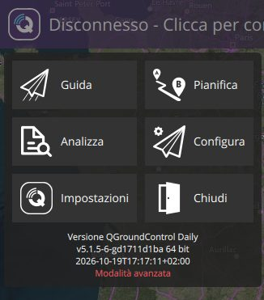
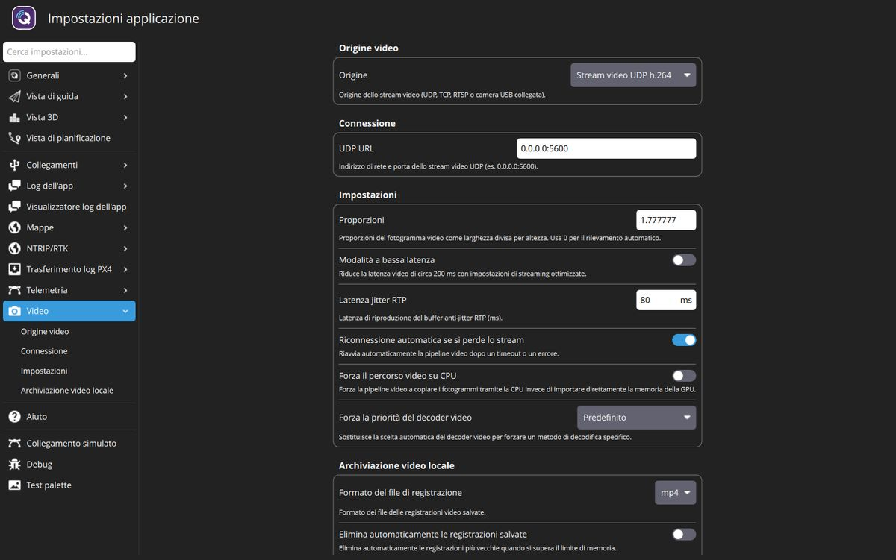

# Guida per il tecnico

Questa guida è per chi installa, configura e mantiene la dashboard del rover MEDEA (QGroundControl
personalizzato). Per l'uso quotidiano vedi la [guida per l'operatore](guida-operatore.md); per
l'elenco delle modifiche e i motivi vedi il [changelog](CHANGELOG.md).

> **Bozza.** Descrive la versione in sviluppo (ottobre 2026). Il bridge Kafka → MAVLink che collega la
> dashboard al rover reale è ancora in preparazione.

## Modalità tecnico (modalità avanzata)

L'operatore vede solo **Guida**, **Pianifica** e **Chiudi**. Tutto ciò che è tecnico è dietro la
**modalità avanzata**, che è spenta a ogni avvio del programma.

**Attivarla:** tocca la **Q** in alto a sinistra, poi **tieni premuto** sulla scritta della versione in
fondo al menu (su desktop basta anche Shift+clic) e conferma con **Sì**. Sotto la versione compare in
rosso *Modalità avanzata*.



**Disattivarla:** stesso gesto, poi conferma *Disattivare la modalità avanzata?*. In ogni caso si
spegne alla chiusura del programma: prima di lasciare la postazione all'operatore disattivala o
riavvia il programma.

In modalità avanzata tornano:

- nel menu: **Analizza**, **Configura** (configurazione del veicolo) e **Impostazioni**;
- negli indicatori della barra in alto: la parte "espandi" con le impostazioni (per esempio la base
  RTK nel pannello GPS);
- nella Fly View: l'ingranaggio delle impostazioni della camera (griglia, adattamento, ripristino e
  formattazione della memoria);
- nella Plan View: *Info veicolo* (firmware e tipo di veicolo per la pianificazione), *Predefiniti*,
  *Punti di raccolta*, *Trasforma* e *Impostazioni iniziali della camera*.

## Prima installazione di una postazione

1. **Lingua:** il valore predefinito è *Sistema*: su un computer in italiano l'interfaccia è già in
   italiano. Altrimenti *Impostazioni → Generali → Lingua → Italiano* e riavvia.
2. **Collegamento con il rover:** il programma ascolta i veicoli MAVLink su UDP (porta 14550) e si
   collega da solo. La connessione automatica a Pixhawk, radio SiK e LibrePilot è disattivata. Il
   bridge Kafka → MAVLink girerà sullo stesso computer e invierà i dati su UDP. Collegamenti manuali:
   *Impostazioni → Collegamenti*.
3. **Video:** vedi la sezione [Video](#video).
4. **Schermo:** unità europee (m, km/h, ettari, °C) e scala dell'interfaccia al 115% sono già
   impostate (*Impostazioni → Generali*). Per lavorare al sole scegli *Schema colori → Esterni*
   (chiaro): sul PC il predefinito è *Interni* (scuro), sul tablet *Esterni*.
5. **Prova:** senza rover puoi provare la postazione con il [collegamento simulato](#prove-senza-rover)
   e con uno [stream video di prova](#provare-il-video-senza-camere).

## Video

Il video è **sempre attivo** e non si può disattivare. Di serie il programma aspetta uno stream
**UDP h.264 sulla porta 5600** (indirizzo `0.0.0.0:5600`): se la camera invia lì, il video compare
nella Fly View senza configurare nulla. Nelle impostazioni si sceglie solo il profilo dello stream.



*Impostazioni → Video*:

- **Origine video → Origine:** *Stream video UDP h.264* (predefinito), *UDP h.265*, *Stream video
  RTSP*, *TCP*, *MPEG-TS* o una camera USB collegata (compare con il suo nome).
- **Connessione:** l'indirizzo dello stream. Per UDP indirizzo e porta su cui ascoltare (per esempio
  `0.0.0.0:5600`); per RTSP l'URL della camera (per esempio `rtsp://192.168.1.20:8554/rgb`).
- **Impostazioni:**
  - *Modalità a bassa latenza*: circa 200 ms di ritardo in meno, a costo di più scatti se la rete
    perde pacchetti;
  - *Forza la priorità del decoder video*: se il riquadro resta su *IN ATTESA DEL VIDEO* anche se la
    camera trasmette, prova *Forza decoder software* (serve il riavvio).
- **Archiviazione video locale:** formato e spazio massimo delle registrazioni fatte con il pulsante
  rosso della Fly View.

Chiedere che le camere del rover trasmettano **H.264 in profilo baseline o main**: nelle prove uno
stream in profilo *high* non veniva mostrato con il decoder automatico.

Per mostrare sia la camera RGB sia quella termica andrà valutato il protocollo camera MAVLink (il
bridge annuncia gli stream e QGroundControl permette di scegliere quale vedere): oggi le impostazioni
gestiscono uno stream alla volta.

### Provare il video senza camere

Con GStreamer installato (è un requisito di QGroundControl) si può inviare un'immagine di prova.

UDP h.264 sulla porta predefinita, senza toccare le impostazioni:

```bash
gst-launch-1.0 videotestsrc is-live=true \
  ! video/x-raw,width=640,height=480,framerate=25/1 \
  ! x264enc tune=zerolatency bitrate=800 key-int-max=25 ! video/x-h264,profile=baseline \
  ! rtph264pay config-interval=1 pt=96 ! udpsink host=127.0.0.1 port=5600
```

RTSP, con il server [MediaMTX](https://github.com/bluenviron/mediamtx) (impostare poi l'URL
`rtsp://127.0.0.1:8554/camera`):

```bash
printf 'paths:\n  all_others:\n' > mediamtx.yml
mediamtx mediamtx.yml &
gst-launch-1.0 videotestsrc is-live=true \
  ! video/x-raw,width=1280,height=720,framerate=25/1 \
  ! x264enc tune=zerolatency bitrate=1500 key-int-max=25 ! video/x-h264,profile=baseline \
  ! rtspclientsink location=rtsp://127.0.0.1:8554/camera
```

## Veicolo preferito e funzioni da drone

*Impostazioni → Generali → Preferenze veicolo → Veicolo preferito* vale **Rover**. Con questo valore
sono nascoste le pagine *ADSB Server* e *Remote ID* e le impostazioni che riguardano solo i mezzi
aerei (altitudini, VTOL, decollo, atterraggi). Scegliendo *Nessuna preferenza* o un altro veicolo
tornano tutte: le funzioni da drone sono nascoste, non rimosse.

L'interfaccia di guida e di pianificazione segue invece il tipo del veicolo collegato: con un rover
non compaiono Decollo e Atterra, con un drone sì.

## Tipi di lavoro

| Modello | Cosa genera |
| --- | --- |
| **Percorso** | I punti della linea disegnata, in ordine; con *Andata e ritorno* anche il ritorno lungo la stessa linea; il tutto ripetuto *Ripetizioni* volte. |
| **Perimetro** | Gli angoli dell'area, spostati verso l'interno della *Distanza dal bordo*, fino a richiudere il giro; il tutto ripetuto *Giri* volte. |
| **Survey** | Passate parallele sull'area (pattern di upstream, ancora con le opzioni da drone). |
| **Nessun modello** | Piano vuoto, i waypoint si aggiungono a mano. |

- Percorso e Perimetro generano solo waypoint (`MAV_CMD_NAV_WAYPOINT`); i modelli aggiungono alla fine
  il ritorno alla partenza (RTL). L'altitudine dei punti è quella predefinita della missione e per il
  rover non ha effetto.
- Gli ultimi valori usati (distanza dal bordo, giri, ripetizioni...) diventano i valori proposti per il
  lavoro successivo.
- I piani si salvano in file `.plan` (JSON). Un file che contiene Percorso o Perimetro si apre solo con
  questa versione di QGroundControl.
- La velocità usata per stimare la durata della missione è 1 m/s (in modalità avanzata:
  *Plan View → Predefiniti*).
- I valori mostrati in basso a destra nella Fly View si possono cambiare: tasto destro (o pressione
  prolungata) sulla griglia, poi il lucchetto per chiudere.

## Preconfigurare una postazione

Per installare più postazioni uguali, o per bloccare un'impostazione, si può mettere un file di
override nella cartella `Settings` dentro la cartella dei dati del programma (quella indicata in
*Impostazioni → Generali → Percorso di caricamento/salvataggio dell'applicazione*, di solito
`Documenti/QGroundControl`). Il file deve avere estensione `.settings` e viene letto all'avvio.

Esempio `Settings/medea.settings` che fissa il video sulla camera RTSP del rover e propone il suo
indirizzo (provato):

```json
{
    "version": 1,
    "fileType": "Settings",
    "groups": {
        "Video": {
            "videoSource": { "forceRawValue": "RTSP Video Stream" },
            "rtspUrl": { "default": "rtsp://192.168.1.20:8554/rgb" }
        }
    }
}
```

- `forceRawValue` impone il valore e nasconde l'impostazione;
- `default` cambia solo il valore predefinito (si può ancora modificare; vale finché non è stato
  salvato un valore diverso);
- `visible: false` nasconde l'impostazione lasciando il valore predefinito.

I nomi dei gruppi e delle impostazioni sono quelli dei file `src/Settings/*.SettingsGroup.json`; i
valori delle scelte vanno scritti in inglese, come nel codice (per esempio `"RTSP Video Stream"`).

Limite noto: se un file nasconde tutte le impostazioni di un gruppo che ha voci condizionate (per esempio
sia la sorgente sia l'URL del video), nella pagina resta il titolo del gruppo con un riquadro vuoto. È
solo estetico.

## Prove senza rover

Nelle build di sviluppo (Debug) c'è un rover simulato: *Impostazioni → Collegamento simulato*, *Tipo di
veicolo → Veicolo APM ArduRover*, **Avvia collegamento simulato**. Si può caricare un lavoro e
avviarlo, ma il veicolo simulato non si muove. Compaiono anche degli aerei simulati e un avviso in
inglese sulla versione del firmware: con il rover reale non ci saranno.

## File e cartelle

Nella cartella dei dati del programma (vedi sopra):

| Cartella | Contenuto |
| --- | --- |
| `Missions` | Piani salvati (`.plan`). |
| `Video` | Registrazioni video. |
| `Logs` | Log di telemetria. |
| `Settings` | File di override delle impostazioni. |
| `CrashLogs` | Rapporti di errore del programma. |

Per tornare ai valori di fabbrica: *Impostazioni → Generali → Cancella tutte le impostazioni al
prossimo avvio*, poi riavvia.

## Per chi sviluppa

- Compilazione ed esecuzione: `README.md` del repository principale `medea_hmi`.
- Modifiche e motivazioni: [CHANGELOG.md](CHANGELOG.md).
- Test dei nuovi tipi di lavoro: `ctest --test-dir build -R "PathComplexItemTest|PerimeterComplexItemTest"`.
- I test di interfaccia di upstream (`test/QmlUITests`) girano con la configurazione di serie (drone,
  scala 100%, modalità avanzata): `QmlUITestBase::startUI()` la imposta, perché l'interfaccia da drone
  esiste ancora.
